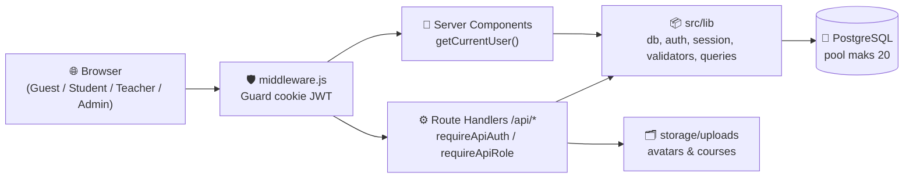

<div align="center">


# Academyya LMS 🎓📚

**Learn Skills. Build Your Future.**
Platform Learning Management System Berbasis Web dengan Sertifikat Digital Terverifikasi


**Tugas Mata Kuliah Pemrograman Web - Universitas Hasanuddin**

</div>

Academyya adalah aplikasi **Learning Management System (LMS)** berbasis web yang dibangun dengan **Next.js (App Router)** dan **PostgreSQL** (`pg`, raw SQL terparameter tanpa ORM). Platform ini mendukung pembelajaran terstruktur untuk tiga peran pengguna (**Student**, **Teacher**, dan **Admin**), lengkap dengan pelacakan progres materi, forum diskusi, notifikasi in-app, serta penerbitan dan verifikasi sertifikat digital.

---

## 📑 Daftar Isi

- [✨ Core Features & Technical Implementation](#-core-features--technical-implementation)
- [🛠️ Tech Stack](#️-tech-stack)
- [📐 System Architecture](#-system-architecture)
- [🗄️ Database Schema](#️-database-schema)
- [📂 Struktur Direktori](#-struktur-direktori)
- [🌐 REST API Endpoints](#-rest-api-endpoints)
- [🚀 Panduan Instalasi Lokal](#-panduan-instalasi-lokal)
- [🧪 Testing & Deployment](#-testing--deployment)

---

## ✨ Core Features & Technical Implementation

### 1. 🌐 Halaman Publik & Eksplorasi Katalog

- **Beranda (`/`)**: Ringkasan statistik platform (`total_courses`, `total_students`, `total_teachers`), hingga 4 course terpopuler, panduan 4 langkah cara belajar, FAQ interaktif (`FaqSection`), Hero Section berlapis (`HeroVisual` dengan animasi CSS GPU dan dukungan `prefers-reduced-motion`), serta banner kontekstual (*Lanjutkan Belajarmu* untuk Student atau ajakan menjadi Teacher).
- **Katalog Course (`/courses`)**: Pencarian berdasarkan judul/deskripsi, filter kategori dan level (pemula, menengah, lanjut), pengurutan (Terbaru / Terpopuler), dan paginasi (12 item per halaman) yang tersinkron ke parameter URL melalui `GET /api/courses`.
- **Detail Course (`/courses/[slug]`)**: Informasi pengajar, metrik jumlah materi dan total durasi, silabus berurutan, serta status pendaftaran. Course berstatus *draft* hanya dapat diakses oleh pengajar pemiliknya atau Admin.

### 2. 🔐 Autentikasi & Otorisasi Berbasis Peran (RBAC)

- **Registrasi & Login**: Pendaftaran sebagai Student atau calon Teacher (`POST /api/auth/register`), serta login/logout (`POST /api/auth/login`, `POST /api/auth/logout`) dengan hash kata sandi `bcryptjs` (cost factor 10).
- **Sesi JWT Cookie**: Token JWT HS256 (`jose`) berdurasi 7 hari yang disimpan pada HTTP-only cookie `academyya_session`.
- **Guard Bertingkat**: `src/middleware.js` memeriksa keabsahan cookie sesi untuk rute terproteksi (`/certificates`, `/dashboard`, `/learn`, `/profile`, `/teacher`, `/admin`). Pengecekan peran database dijalankan oleh Server Component layout/halaman (`getCurrentUser()`) dan API guards (`requireApiAuth`, `requireApiRole`), lalu disinkronkan melalui `GET /api/auth/me`.

### 3. 📖 Ruang Belajar, Progres & Diskusi Materi

- **Enrollment & Ruang Belajar (`/learn/[course]/[materi]`)**: Student dapat mendaftar ke course *published* (`POST /api/enrollments`). Ruang belajar menyediakan navigasi materi sebelumnya/berikutnya, pemutar video embed YouTube/Vimeo (`toEmbedVideoUrl`), konten teks multi-paragraf, serta mode pratinjau bagi pengajar pemilik dan Admin.
- **Pelacakan Progres (Mark as Done)**: Menandai atau membatalkan status selesai materi dalam **transaksi SQL** (`POST /api/progress/toggle`) sekaligus menghitung ulang persentase penyelesaian secara dinamis.
- **Forum Diskusi Materi**: Tanya-jawab khusus peserta terdaftar, pengajar pemilik course, dan Admin (`GET/POST /api/materials/[id]/discussions`) dengan struktur pertanyaan induk dan balasan satu tingkat (`parent_id`).

### 4. 🏅 Sertifikat Digital & Cetak PDF

- **Penerbitan Otomatis**: Saat progres mencapai 100%, transaksi SQL memperbarui status enrollment menjadi `completed` dan menerbitkan kode verifikasi unik berformat `ACAD-YYYY-XXXXXX`.
- **Daftar & Verifikasi Publik**: Student melihat koleksinya di `/certificates`, sedangkan publik maupun API (`GET /api/certificates/[code]`) dapat memverifikasi dan mencetak sertifikat di `/certificates/[code]` dengan tata letak cetak **A4 lanskap** (297mm x 209.5mm).

### 5. 👤 Profil, Pengajuan Teacher, Notifikasi & Storage Lokal

- **Pengaturan Profil (`/profile`)**: Pembaruan nama, bio, kata sandi, dan foto profil (`PUT /api/profile` via `multipart/form-data` atau JSON).
- **Pengajuan Teacher & Notifikasi**: Student dapat mengajukan atau mengajukan ulang peran Teacher (`/api/teacher-applications`) dan memantau notifikasi melalui ikon lonceng pada Navbar (`/api/notifications`, `/api/notifications/read`).
- **Penyimpanan Gambar Lokal**: Avatar (maks 2 MB) disimpan di `storage/uploads/avatars/` dan sampul course (maks 5 MB) di `storage/uploads/courses/` setelah validasi *magic bytes* (JPEG/PNG/WebP, menolak SVG), lalu disajikan melalui `/api/uploads/avatars/[filename]` dan `/api/uploads/courses/[filename]`.

### 6. 🧑‍🏫 Panel Pengajar (`/teacher`) & 🛡️ Panel Admin (`/admin`)

- **Teacher Panel**: Ringkasan metrik mengajar, pembuatan dan penyuntingan course beserta upload foto sampul (`FormData`), toggle *published/draft* (syarat minimal 1 materi), manajemen materi CRUD dan pengurutan ulang atomik (memanfaatkan constraint `DEFERRABLE INITIALLY DEFERRED`), serta pemantauan progres siswa (`/teacher/students`).
- **Admin Panel**: Statistik platform (`GET /api/admin/stats`), peninjauan pengajuan Teacher (approve/reject dengan promosi peran dan notifikasi transaksional), CRUD kategori (dilindungi `ON DELETE RESTRICT`), moderasi status/materi/hapus course, serta pengelolaan akun pengguna (mencegah penghapusan akun sendiri).

### 7. ♿ Aksesibilitas & UI

- Pengaturan ukuran teks dinamis **A− / A+** (Normal 100%, Besar 112.5%, Ekstra Besar 125%) yang tersimpan di `localStorage` (`FontSizeContext` & `FontSizeControl`).
- Dukungan `@media (prefers-reduced-motion: reduce)`, navigasi `:focus-visible`, sistem toast notifikasi (`ToastContext`), serta `Modal` / `ConfirmModal` dengan penutupan via tombol `Escape` maupun backdrop.

---

## 🛠️ Tech Stack

Sesuai `package.json`, `next.config.mjs`, `eslint.config.mjs`, dan `jsconfig.json`:

| Kategori | Teknologi | Versi / Keterangan |
| --- | --- | --- |
| Framework | Next.js (App Router) | 16.4.6 (Turbopack CSS loader via `@tailwindcss/turbopack`) |
| UI Library | React & React DOM | 19.3.0 |
| Styling | Tailwind CSS & `@tailwindcss/turbopack` | 4.3.3 |
| Basis Data | PostgreSQL (`pg`) | ^8.23.1 (raw SQL terparameter, connection pool maks 20) |
| Keamanan & Sesi | `jose` & `bcryptjs` | ^6.2.17 (JWT HS256) & ^3.0.3 (password hashing) |
| Ikon | `lucide-react` | ^1.73.0 |
| Linter | ESLint & `eslint-config-next` | ^9 & 16.4.6 (core-web-vitals) |
| Path Alias | `jsconfig.json` | `@/*` mengarah ke `./src/*` |

---

## 📐 System Architecture

Aplikasi menggunakan arsitektur **Next.js full-stack**: Server Component dan Route Handler berjalan dalam satu proyek, dengan akses basis data langsung melalui raw SQL terparameter.



---

## 🗄️ Database Schema

Skema didefinisikan di `db/schema.sql` (**12 tabel & 11 indeks**) dengan seed demo di `db/seed.sql`. Beberapa keputusan desain penting:

| Aspek | Implementasi |
| --- | --- |
| Query | Raw SQL terparameter melalui `pg` (connection pool maks 20) |
| Konsistensi data | Progres materi dan penerbitan sertifikat dijalankan dalam transaksi SQL |
| Urutan materi | Pengurutan ulang atomik dengan constraint `DEFERRABLE INITIALLY DEFERRED` |
| Integritas kategori | Relasi kategori dilindungi `ON DELETE RESTRICT` |
| Forum diskusi | Struktur induk-balasan satu tingkat melalui kolom `parent_id` |
| Kode sertifikat | Format unik `ACAD-YYYY-XXXXXX` |

> **Catatan:** Skema juga mendefinisikan tabel `reviews` dan `bookmarks`, namun keduanya belum digunakan oleh fitur atau API mana pun pada direktori `src/`.

---

## 📂 Struktur Direktori

```text
.
├── db/
│   ├── schema.sql                  # DDL PostgreSQL (12 tabel & 11 indeks)
│   └── seed.sql                    # Data awal demo (akun, kategori, course, materi)
├── public/
│   ├── images/courses/             # Gambar sampul default bawaan course
│   ├── logo.png                    # Logo Academyya (navbar, footer, sertifikat)
│   └── Object.svg                  # Ilustrasi utama Hero Section
├── src/
│   ├── middleware.js               # Guard sesi JWT Edge-safe & redirect halaman auth
│   ├── app/
│   │   ├── globals.css             # Token @theme Tailwind v4, animasi Hero, aturan print A4
│   │   ├── layout.js               # Root layout (Poppins, Inter, FontSizeProvider, ToastProvider)
│   │   ├── (public)/               # /, /courses, /courses/[slug], /certificates/[code], /login, /register
│   │   ├── (student)/              # /dashboard, /certificates, /profile, /learn/[course]/[materi]
│   │   ├── (teacher)/teacher/      # Teacher Panel: ringkasan, kelola course, materi, progres siswa
│   │   ├── (admin)/admin/          # Admin Panel: statistik, verifikasi teacher, kategori, moderasi, pengguna
│   │   └── api/                    # 30 Route Handler API
│   ├── components/                 # Komponen UI per domain (admin, auth, course, home, layout, learning, student, teacher, ui)
│   └── lib/                        # Helper inti (db, auth, session, validators, uploadStorage, queries/*)
├── storage/                        # Unggahan runtime (diabaikan di .gitignore)
├── .env.example                    # Contoh daftar nama variabel environment
├── eslint.config.mjs               # Konfigurasi ESLint
├── jsconfig.json                   # Alias path @/*
├── next.config.mjs                 # Konfigurasi Next.js (Turbopack CSS)
└── package.json                    # Dependensi dan script NPM
```

---

## 🌐 REST API Endpoints

Autentikasi memakai sesi JWT pada HTTP-only cookie `academyya_session`. Contoh beberapa jalur utama:

| Endpoint | Method | Akses | Deskripsi |
| --- | --- | --- | --- |
| `/api/auth/register` | POST | Publik | Mendaftarkan Student atau calon Teacher (bcrypt hashed) |
| `/api/auth/login` | POST | Publik | Login dan menerbitkan cookie sesi JWT |
| `/api/auth/me` | GET | Login | Sinkronisasi data & peran pengguna aktif |
| `/api/courses` | GET | Publik | Katalog course: pencarian, filter, sort, paginasi |
| `/api/enrollments` | POST | Student | Mendaftar ke course berstatus published |
| `/api/progress/toggle` | POST | Student | Menandai/membatalkan materi selesai (transaksi SQL) |
| `/api/materials/[id]/discussions` | GET, POST | Peserta, Teacher pemilik, Admin | Forum diskusi materi |
| `/api/certificates/[code]` | GET | Publik | Verifikasi sertifikat digital |
| `/api/profile` | PUT | Login | Update profil & foto (multipart/JSON) |
| `/api/teacher-applications` | GET, POST | Student | Pengajuan peran Teacher |
| `/api/notifications` | GET | Login | Histori notifikasi pengguna |
| `/api/admin/stats` | GET | Admin | Statistik platform |

---

## 🚀 Panduan Instalasi Lokal

### Prasyarat

- Node.js dan npm
- PostgreSQL yang berjalan lokal atau dapat diakses melalui string koneksi

### 1. Instalasi Dependensi

```bash
npm install
```

### 2. Konfigurasi Variabel Environment

Salin `.env.example` menjadi `.env.local` (atau `.env`) di direktori root, lalu isi nilainya:

```bash
cp .env.example .env.local
# Edit .env.local: isi DATABASE_URL dan JWT_SECRET
```

| Variabel | Deskripsi |
| --- | --- |
| `DATABASE_URL` | String koneksi basis data PostgreSQL |
| `JWT_SECRET` | Kunci rahasia acak (disarankan minimal 32 karakter) untuk JWT HS256 |

> **Catatan:** Pada `src/lib/session.js` terdapat nilai fallback pengembangan jika `JWT_SECRET` belum disetel, namun tetap isi dengan secret yang aman sebelum dijalankan.

### 3. Inisialisasi Basis Data

1. Buat basis data PostgreSQL baru sesuai nama pada `DATABASE_URL`.
2. Jalankan `db/schema.sql` untuk membuat tabel dan indeks.
3. *(Opsional)* Jalankan `db/seed.sql` untuk data demo.

> ⚠️ **Perhatian:** `db/schema.sql` diawali `DROP TABLE IF EXISTS ... CASCADE`, sehingga akan menghapus tabel lama jika dijalankan ulang pada database yang sudah berisi data.

**Akun demo** (kata sandi tercantum di komentar `db/seed.sql`):

| Peran | Email |
| --- | --- |
| Admin | `admin@academyya.id` |
| Teacher | `budi.teacher@academyya.id`, `siti.teacher@academyya.id` |
| Calon Teacher | `rizky.calon@academyya.id` |
| Student | `andi.student@academyya.id`, `ratna.student@academyya.id` |

### 4. Menjalankan Aplikasi

```bash
npm run dev
```

Buka browser di **http://localhost:3000** 🎉

---

## 🧪 Testing & Deployment

| Perintah | Deskripsi |
| --- | --- |
| `npm run dev` | Menjalankan server pengembangan Next.js (default `http://localhost:3000`) |
| `npm run lint` | Analisis statik ESLint (`core-web-vitals`) untuk menjaga konvensi kode |
| `npm run build` | Membangun bundel produksi Next.js |
| `npm run start` | Menjalankan server produksi (setelah `npm run build`) |

---

<div align="center">

Didesain dan dikembangkan untuk Universitas Hasanuddin
© 2026 Academyya - Pemrograman Web

</div>